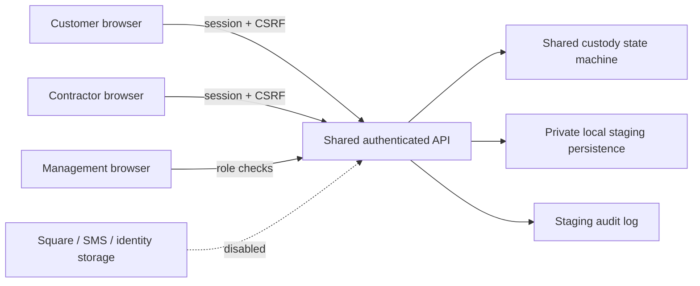

# Staging threat model and release gates

This implementation is private, single-process local staging with synthetic fixtures. It is not approved for customer data, identity documents, real payments or Internet deployment. Documentation in the supplied package is project input; the owner's chat instructions govern authority. No public launch or sensitive integration is authorized.

## Data flow and trust boundaries

Browser state and submitted user IDs, roles, paid flags, scan verification flags and timestamps are untrusted. The server derives actor identity from its session, verifies account ownership and assigned contractor, and validates bag/station tokens against server state. Static station tokens prove possession of a token, not physical location. Production requires a rotating station credential or additional on-site verification.

Relevant threats include another customer's bag access, contractor job theft, role escalation, forged scan/context flags, unpaid release, duplicate or concurrent custody changes, cross-site requests, credential guessing, stored HTML injection, local credential disclosure and replayed financial events. Synthetic fixture passwords and QR tokens are local private runtime material and must not be committed, shown in browser source, or treated as production credentials.

## Local testable controls

Integration tests exercise authentication, HttpOnly cookies, CSRF, management role boundaries, customer isolation, server scan validation, idempotent retried actions, competing acceptance, weight rounding, staged checkout/return, unpaid pickup refusal and persistence restart. Shared unit tests exercise state transition rules. These checks are useful regression evidence, not a penetration test or proof of production readiness.

Uploads and payment integrations remain disabled. No document upload endpoint should accept files; no client request can assert verified payment. Contractor earnings may remain pending but cannot issue money. Proposed penalties, withholding, agreement activation and sensitive onboarding remain inactive.

## Production release blockers

- Authorized hosting and managed database with deployed and tested migrations, transactional concurrency across processes, row-level authorization and backup/restore drill.
- Managed authentication, verified recovery, MFA for management, secure invite/signup, production HTTPS and secure session cookies, credential and session rotation.
- Independent security-critical review; least-privilege secrets, tamper-resistant remote audit retention, monitoring and incident response.
- Square sandbox account authorization, signature and replay verification, amount/currency/order reconciliation, refunds/disputes and idempotent ledger tests. No real financial connection without owner approval.
- SMS opt-in, expiring single-use codes, rate limits and authorized provider account; rotating station QR with a documented physical-presence limitation.
- Protected upload pipeline, content sniffing and malware scans, private storage, retention/deletion policy, legal review and explicit owner approval before collecting actual identity/tax documents.
- Real iOS Safari/Android Chrome, accessibility and camera permission/recovery tests; manual-entry fallback is not camera scanning.
- Production dependency/secret scans, disaster recovery and external security review before launch. A clean automated test suite does not waive these gates.

## Operating boundaries

Keep the staging server bound to loopback, preserve restrictive runtime-directory permissions, and use fake fixtures only. Do not expose staging credentials through chat, logs or source control. Public links or a production-like URL do not establish deployment authorization. Roll back by stopping the local process and reverting the reviewed feature diff; preserve synthetic runtime data separately if needed. Never overwrite a live database with staging fixtures.

## Unconnected Square adapter groundwork

`server/square-verification.mjs` verifies HMAC-SHA256 over the exact HTTPS notification URL plus untouched raw request bytes, using constant-time equal-length comparison. Its separate reconciliation helper requires a trusted merchant/order/invoice mapping and completed payment with exact integer cents/currency, no refunded amount, and rejects already recorded event IDs. Unit tests cover forgery, URL/body changes, mismatch and duplicate input. The helper does not itself authenticate an event: a future handler must verify the signature first, then parse, reconcile, and atomically store event/payment uniqueness with the order and ledger transition. Its in-memory Set parameter is not durable replay protection. No route imports this module, no provider account is connected, and no payment is marked verified. Provider authorization, independently verified official integration semantics, refunds/disputes reconciliation and sandbox webhook tests remain required before use.
